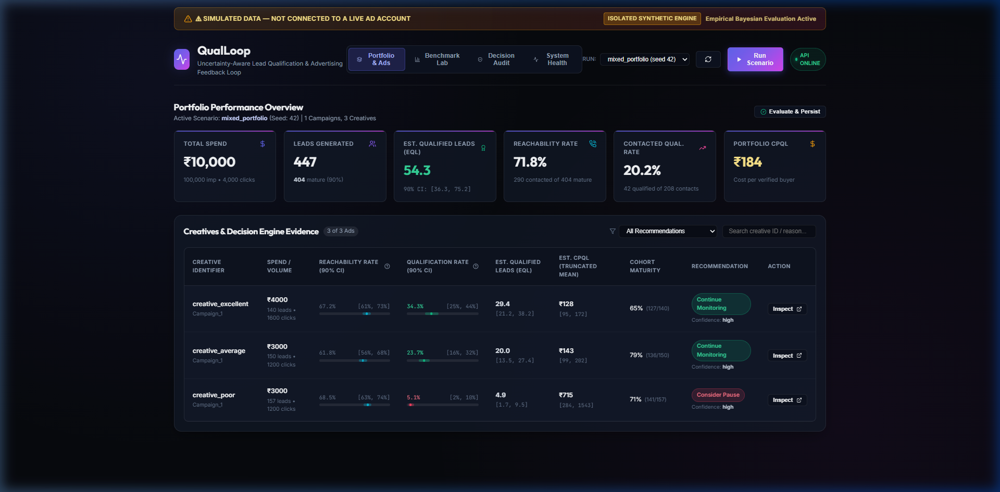
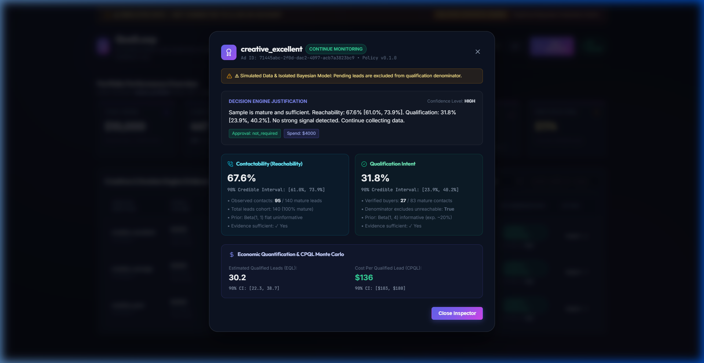
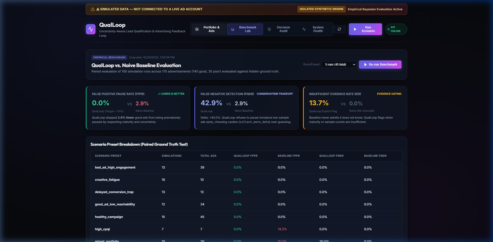
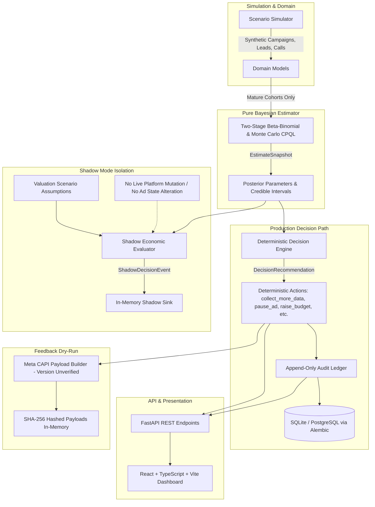

# QualLoop

**QualLoop is an uncertainty-aware decision intelligence engine that evaluates high-consideration advertising campaigns through two-stage Bayesian estimation, cohort maturity gating, and deterministic governance rules. Operating over simulated lead pipelines, it prevents premature ad pauses by distinguishing reachability delays from true sales disqualifications.**

> **Independent Project Disclaimer:** QualLoop is an independent open-source research and engineering prototype; it has no affiliation with, endorsement from, or access to the proprietary systems, databases, or infrastructure of Revspot.

> ⚠ **IMPORTANT PROJECT STATUS & SCOPE**  
> QualLoop is an **empirical simulation-based MVP and research prototype** with an offline economic shadow evaluator. For a detailed breakdown of real-world operational boundaries, consult [docs/LIMITATIONS.md](docs/LIMITATIONS.md).
> - **Simulated Data Only:** All ad metrics, lead statuses, and sales qualification outcomes in the dashboard are generated by a deterministic scenario simulator.
> - **No Live Ad Mutation:** There is no live connection to Meta Marketing API or Google Ads API; no ad pause or budget modification is transmitted to external ad platforms.
> - **Dry-Run CAPI Only:** Meta Conversions API (version unverified) payloads are constructed and cryptographically hashed (SHA-256) in memory with zero external network transmission.
> - **Exploratory Economic Calibration:** The offline economic shadow evaluator computes incremental profit projections and break-even thresholds, but its probability-of-profitability metric is an exploratory model calculation, not calibrated for real-world empirical risk.
> - **No Authentication:** There is currently no multi-tenant authentication, user management, or role-based access control (RBAC).

---

## Visual Tour

| Portfolio Overview | Ad Inspector & Credible Intervals |
|:---:|:---:|
|  |  |

| Benchmark Lab | Interactive Demo Walkthrough |
|:---:|:---:|
|  | [Watch Demo Walkthrough Video](docs/img/demo_walkthrough.webp) |

---

## 1. Problem Statement

Standard advertising platforms (Meta, Google, TikTok) optimize delivery algorithms against top-of-funnel conversion signals: link clicks, landing page views, and initial lead form submissions. In industries with high-consideration sales cycles (B2B SaaS, real estate, healthcare, financial services), optimizing for raw lead volume introduces critical failure modes:

1. **The Reachability Trap (Conflating Contactability with Intent):**  
   A lead who does not answer the phone within 24 hours is uncontacted, not disqualified. When ad platforms or marketing dashboards count unreachable leads as disqualifications, they penalize high-intent audiences that simply work during business hours or take longer to answer. In QualLoop, reachability bias is **handled in simulation** by separating contactability from buyer qualification.
2. **The Cohort Maturity Trap (Premature Decisions on Incomplete Cycles):**  
   Sales qualification takes days or weeks. Standard 7-day reporting attribution windows classify pending leads as failures, leading media buyers to prematurely pause high-performing creatives before their leads have had time to progress through the qualification pipeline.
3. **Point-Estimate Illusion in Low-Volume Regimes:**  
   Standard dashboards display raw empirical ratios (e.g., 1 qualified out of 2 contacted leads = "50% qualification rate") without credible intervals. Media buyers make budget-reallocation decisions on statistical noise, repeatedly cutting ads that are within normal variance.

QualLoop decouples **Reachability (Contactability)** from **Qualification Intent**, enforces **Cohort Maturity Gating**, represents parameter uncertainty via **Bayesian Beta-Binomial posteriors**, computes **Monte Carlo Cost-per-Qualified-Lead (CPQL) distributions**, and immutably records all recommendations to a **persisted audit trail**.

---

## 2. Statistical Methodology

QualLoop models the lead qualification pipeline as a two-stage Bayesian process evaluated only over mature cohorts:

$$\text{Observed Leads } \xrightarrow{\text{Stage 1: Reachability}} \text{Contacted Leads } \xrightarrow{\text{Stage 2: Intent}} \text{Qualified Leads}$$

### 2.1 Stage 1: Reachability ($\theta_{\mathrm{reach}}$)
- **Cohort Gating:** Evaluated strictly on leads older than the contact maturity window (default: 3 days). Pending, recent leads are excluded from the denominator.
- **Prior:** $\text{Beta}(1, 1)$ (uninformative uniform prior over $[0, 1]$).
- **Likelihood:** $\text{Binomial}(n_{\mathrm{mature\_leads}}, k_{\mathrm{contacted}})$.
- **Posterior:** $\text{Beta}(1 + k_{\mathrm{contacted}}, 1 + n_{\mathrm{mature\_leads}} - k_{\mathrm{contacted}})$.

### 2.2 Stage 2: Qualification Intent ($\theta_{\mathrm{qual}}$)
- **Cohort Gating:** Evaluated strictly on mature answered contacts older than the qualification maturity window (default: 7 days). **Unreachable leads are never counted as disqualified.**
- **Prior:** $\text{Beta}(1, 4)$ (informative prior encoding a conservative ~20% qualification expectation, preventing runaway optimism from early small-sample hits).
- **Likelihood:** $\text{Binomial}(n_{\mathrm{mature\_contacts}}, k_{\mathrm{qualified}})$.
- **Posterior:** $\text{Beta}(1 + k_{\mathrm{qualified}}, 4 + n_{\mathrm{mature\_contacts}} - k_{\mathrm{qualified}})$.

### 2.3 Expected Qualified Leads (EQL) & CPQL Uncertainty
Because Cost-per-Qualified-Lead is a nonlinear ratio of spend to random variables, point division $\frac{\text{Spend}}{\mathbb{E}[\text{QL}]}$ obscures severe right-tail skew and mathematical instability. QualLoop uses Monte Carlo propagation (`backend/estimator/cpql.py`):
1. **Draw Posterior Samples:** Draw $S = 10,000$ independent posterior samples (`n_samples = 10_000`):
   $$\theta_{\mathrm{reach}}^{(s)} \sim \text{Posterior}(\theta_{\mathrm{reach}}), \quad \theta_{\mathrm{qual}}^{(s)} \sim \text{Posterior}(\theta_{\mathrm{qual}})$$
2. **Calculate Simulated Mature EQL:**
   $$\text{EQL}^{(s)} = N_{\mathrm{leads}} \times \text{maturity\_fraction} \times \theta_{\mathrm{reach}}^{(s)} \times \theta_{\mathrm{qual}}^{(s)}$$
3. **Prorate Spend Consistently:** To treat spend and lead cohorts consistently when cohorts are partially mature, the spend numerator is scaled to match mature leads:
   $$\text{Effective\_Spend} = \text{Spend} \times \text{maturity\_fraction}$$
4. **Sample CPQL (Truncated Conditional Distribution):**
   $$\text{CPQL}^{(s)} = \frac{\text{Effective\_Spend}}{\text{EQL}^{(s)}} \quad \text{for samples where } \text{EQL}^{(s)} \ge 0.5$$
   The reported `cpql_mean` is the truncated conditional expectation $\mathbb{E}[\text{Spend}/\text{EQL} \mid \text{EQL} \ge 0.5]$, alongside the median `cpql_median` and 90% credible intervals.
5. **Instability Detection:** If more than 20% of posterior mass falls near zero EQL ($\text{EQL} < 0.5$; `instability_threshold = 0.20`), the system flags the creative as `CPQL_UNSTABLE` rather than reporting misleading point values.
6. **Estimator Path:** Both the API service (`backend/api/evaluation.py`) and sequential benchmarking suite (`backend/benchmark/sequential.py`) execute the **empirical-Bayes pooled shrinkage** estimator path (`enable_shrinkage=True`), borrowing statistical strength across ads within campaigns.

---

## 3. Architecture & Data Flow



### Architectural Guardrails Enforced in Code
- **Ground Truth Isolation:** Simulator ground truths ($p_{\mathrm{reach}}$, $p_{\mathrm{intent}}$) exist solely in the simulation module and are never passed to production API routers or frontend schemas.
- **Estimator Independence:** `backend/estimator/` contains pure numerical algorithms (`numpy`, `scipy`) with zero dependency on databases, web frameworks, or network I/O.
- **Deterministic Decision Policy:** Recommendation rules reside exclusively in `backend/decision_engine/` and rely strictly on observable evidence and posterior bounds, emitting one of exactly 13 canonical `DecisionAction` enum values (`backend/domain/enums.py`):
  `collect_more_data`, `continue_monitoring`, `investigate_low_reachability`, `refresh_creative`, `pause_ad`, `consider_pause`, `reallocate_budget`, `consider_reallocate`, `shift_spend`, `raise_budget`, `launch_ad`, `flag_insufficient_evidence`, `flag_abnormal_change`. There is **no `EXPLORE` action** in the system.
- **Shadow Isolation:** The economic evaluator runs in a non-actioning shadow mode (`backend/shadow/`). It receives snapshot data, records telemetry to an isolated sink, and returns the production decision completely unaltered.
- **Dry-Run Feedback:** The Meta CAPI module (`backend/feedback/`) formats and hashes conversion payloads without network egress.

---

## 4. Decision Governance & Tier Model

QualLoop implements a 3-tier governance model (`backend/decision_engine/engine.py:50-88`) regulating automated vs. human-supervised ad actions:

| Governance Tier | Allowed Decision Actions | Execution Semantics | Human Approval |
|---|---|---|:---:|
| **`autonomous`** | `collect_more_data`<br>`continue_monitoring`<br>`investigate_low_reachability`<br>`refresh_creative`<br>`flag_insufficient_evidence` | Safe observational and monitoring recommendations. Pre-approved for autonomous execution. | **Not Required** (`auto_applied=True`) |
| **`within_guardrails`** | `pause_ad`<br>`reallocate_budget`<br>`shift_spend`<br>`consider_pause`<br>`consider_reallocate` | Downside-limiting budget protection actions. Executed autonomously only if ad spend is below policy spend cap ($\le \$500$); otherwise flagged for review. | **Conditional** (Spend $\le \$500$: Pre-approved; Spend $> \$500$: Required) |
| **`gated`** | `raise_budget`<br>`launch_ad`<br>`flag_abnormal_change` | High-stakes mutations expanding capital commitment or responding to anomalous distribution shifts. | **Mandatory Human Sign-Off** (`auto_applied=False`, `requires_human_approval=True`) |

### Real Decision Records from Actual System Runs

Below are 3 authentic decision record JSON objects extracted directly from simulation executions:

<details>
<summary><strong>1. Autonomous Tier Decision Record (Real Run: mixed_portfolio, seed 42)</strong></summary>

* **Scenario:** `mixed_portfolio` | **Seed:** `42` | **Run ID:** `8826d916-cdfb-21c6-c1ff-91a761565a70`
* **Advertisement ID:** `71445abc-2f0d-dac2-4097-acb7a3823bc9` | **Creative ID:** `creative_excellent`

```json
{
  "id": "a9f0265f-3f75-4d58-92f5-10603b9e3ad1",
  "advertisement_id": "71445abc-2f0d-dac2-4097-acb7a3823bc9",
  "estimate_snapshot_id": "267510ba-727b-478a-a706-a0de56661e82",
  "policy_version": "v0.2.0",
  "action": "continue_monitoring",
  "reason": "Sample is mature (127 mature leads, 62 mature contacts, 22 qualified). Reachability mean 67.2% (90% CI: [61.3%, 72.9%]), qualification mean 34.3% (90% CI: [25.1%, 44.0%]), EQL 29.4, spend ₹4000.00. No failure threshold triggered; continue autonomous monitoring.",
  "supporting_metrics": {
    "inputs": {
      "ad_spend": 4000.0,
      "n_leads": 140,
      "n_mature_leads": 127,
      "n_contacts": 95,
      "n_mature_contacts": 62,
      "k_qualified": 22,
      "maturity_fraction_contact": 0.9071,
      "maturity_fraction_qualification": 0.6526
    },
    "posterior_summary": {
      "ci_level": 0.9,
      "reachability_mean": 0.6719,
      "reachability_ci": [
        0.6129,
        0.7287
      ],
      "qualification_mean": 0.3427,
      "qualification_ci": [
        0.2509,
        0.4398
      ],
      "eql_mean": 29.37,
      "cpql_mean": 127.65,
      "cpql_ci": [
        94.88,
        171.53
      ],
      "cpql_unstable": false,
      "zero_eql_fraction": 0.0
    },
    "thresholds": {
      "min_mature_leads": 30,
      "min_mature_contacts": 20,
      "min_maturity_fraction": 0.6,
      "low_reachability_upper_bound": 0.25,
      "low_qualification_upper_bound": 0.1,
      "high_cpql_lower_bound": 500.0,
      "target_cpql": 75.0,
      "budget_guardrail_min_spend": 100.0,
      "spend_shift_cap_fraction": 0.25,
      "guardrail_action_spend_cap": 500.0
    },
    "tier": "autonomous",
    "auto_applied": true,
    "policy_version": "v0.2.0",
    "n_leads": 140,
    "n_mature_leads": 127,
    "n_contacts": 95,
    "n_mature_contacts": 62,
    "k_qualified": 22,
    "maturity_fraction_contact": 0.9071,
    "reachability_mean": 0.6719,
    "reachability_ci_low": 0.6129,
    "reachability_ci_high": 0.7287,
    "qualification_mean": 0.3427,
    "qualification_ci_low": 0.2509,
    "qualification_ci_high": 0.4398,
    "eql_mean": 29.37,
    "cpql_mean": 127.65,
    "cpql_unstable": false,
    "evidence_sufficient_reachability": true,
    "evidence_sufficient_qualification": true,
    "ci_level": 0.9,
    "thresholds_applied": {
      "min_mature_leads": 30,
      "min_mature_contacts": 20,
      "min_maturity_fraction": 0.6,
      "low_reachability_upper_bound": 0.25,
      "low_qualification_upper_bound": 0.1,
      "high_cpql_lower_bound": 500.0,
      "target_cpql": 75.0,
      "budget_guardrail_min_spend": 100.0,
      "spend_shift_cap_fraction": 0.25,
      "guardrail_action_spend_cap": 500.0
    }
  },
  "confidence_level": "high",
  "tier": "autonomous",
  "auto_applied": true,
  "requires_human_approval": false,
  "approval_status": "not_required",
  "created_at": "2026-10-29T13:49:03.279559Z",
  "simulation_run_id": "8826d916-cdfb-21c6-c1ff-91a761565a70",
  "is_persisted": false
}
```
</details>

<details>
<summary><strong>2. Within-Guardrails Tier Decision Record (Real Run: mixed_portfolio, seed 42)</strong></summary>

* **Scenario:** `mixed_portfolio` | **Seed:** `42` | **Run ID:** `8826d916-cdfb-21c6-c1ff-91a761565a70`
* **Advertisement ID:** `9e85e7c0-8602-9246-dbaa-63c54648cea7` | **Creative ID:** `creative_poor`

```json
{
  "id": "f7771afc-64a1-47e9-b8b6-6589be5cfb47",
  "advertisement_id": "9e85e7c0-8602-9246-dbaa-63c54648cea7",
  "estimate_snapshot_id": "f3a4f6ce-fd5f-464f-94db-1b5e62ef9364",
  "policy_version": "v0.2.0",
  "action": "consider_pause",
  "reason": "With 75 mature contacts (3 qualified), the 90% credible interval for qualification rate is [1.8%, 9.6%], sitting entirely below threshold 10.0%. Reachability is adequate (68.5%), confirming poor buying intent. Recommending pause for human review (spend: ₹3000.00, guardrail cap: ₹500.00).",
  "supporting_metrics": {
    "inputs": {
      "ad_spend": 3000.0,
      "n_leads": 157,
      "n_mature_leads": 141,
      "n_contacts": 105,
      "n_mature_contacts": 75,
      "k_qualified": 3,
      "maturity_fraction_contact": 0.8981,
      "maturity_fraction_qualification": 0.7143
    },
    "posterior_summary": {
      "ci_level": 0.9,
      "reachability_mean": 0.6854,
      "reachability_ci": [
        0.6292,
        0.7395
      ],
      "qualification_mean": 0.0508,
      "qualification_ci": [
        0.018,
        0.0962
      ],
      "eql_mean": 4.93,
      "cpql_mean": 714.58,
      "cpql_ci": [
        284.48,
        1543.49
      ],
      "cpql_unstable": false,
      "zero_eql_fraction": 0.0007
    },
    "thresholds": {
      "min_mature_leads": 30,
      "min_mature_contacts": 20,
      "min_maturity_fraction": 0.6,
      "low_reachability_upper_bound": 0.25,
      "low_qualification_upper_bound": 0.1,
      "high_cpql_lower_bound": 500.0,
      "target_cpql": 75.0,
      "budget_guardrail_min_spend": 100.0,
      "spend_shift_cap_fraction": 0.25,
      "guardrail_action_spend_cap": 500.0
    },
    "tier": "within_guardrails",
    "auto_applied": false,
    "policy_version": "v0.2.0",
    "n_leads": 157,
    "n_mature_leads": 141,
    "n_contacts": 105,
    "n_mature_contacts": 75,
    "k_qualified": 3,
    "maturity_fraction_contact": 0.8981,
    "reachability_mean": 0.6854,
    "reachability_ci_low": 0.6292,
    "reachability_ci_high": 0.7395,
    "qualification_mean": 0.0508,
    "qualification_ci_low": 0.018,
    "qualification_ci_high": 0.0962,
    "eql_mean": 4.93,
    "cpql_mean": 714.58,
    "cpql_unstable": false,
    "evidence_sufficient_reachability": true,
    "evidence_sufficient_qualification": true,
    "ci_level": 0.9,
    "thresholds_applied": {
      "min_mature_leads": 30,
      "min_mature_contacts": 20,
      "min_maturity_fraction": 0.6,
      "low_reachability_upper_bound": 0.25,
      "low_qualification_upper_bound": 0.1,
      "high_cpql_lower_bound": 500.0,
      "target_cpql": 75.0,
      "budget_guardrail_min_spend": 100.0,
      "spend_shift_cap_fraction": 0.25,
      "guardrail_action_spend_cap": 500.0
    }
  },
  "confidence_level": "high",
  "tier": "within_guardrails",
  "auto_applied": false,
  "requires_human_approval": true,
  "approval_status": "pending",
  "created_at": "2026-10-29T13:49:03.279559Z",
  "simulation_run_id": "8826d916-cdfb-21c6-c1ff-91a761565a70",
  "is_persisted": false
}
```
</details>

<details>
<summary><strong>3. Gated Tier Decision Record (Real Run: healthy_campaign, seed 42)</strong></summary>

* **Scenario:** `healthy_campaign` | **Seed:** `42` | **Run ID:** `8826d916-cdfb-21c6-c1ff-91a761565a70`
* **Advertisement ID:** `239c93ad-43a8-6c24-feb5-cf09346a821c` | **Creative ID:** `creative_C`

```json
{
  "id": "8dbeddeb-28f1-483f-bec4-0d766ffa60e5",
  "advertisement_id": "239c93ad-43a8-6c24-feb5-cf09346a821c",
  "estimate_snapshot_id": "0948460f-da62-44b3-8576-c31760c6d2d2",
  "policy_version": "v0.2.0",
  "action": "raise_budget",
  "reason": "Mature evidence confirmed (133 mature leads, 61 contacts, 13 qualified). Credible interval upper bound for CPQL (₹31.61) is strictly below target CPQL (₹75.00) with mean CPQL ₹23.44. Recommend raising budget (gated tier: human approval required).",
  "supporting_metrics": {
    "inputs": {
      "ad_spend": 500.0,
      "n_leads": 151,
      "n_mature_leads": 133,
      "n_contacts": 93,
      "n_mature_contacts": 61,
      "k_qualified": 13,
      "maturity_fraction_contact": 0.8808,
      "maturity_fraction_qualification": 0.6559
    },
    "posterior_summary": {
      "ci_level": 0.9,
      "reachability_mean": 0.6408,
      "reachability_ci": [
        0.5818,
        0.6981
      ],
      "qualification_mean": 0.2279,
      "qualification_ci": [
        0.1656,
        0.2958
      ],
      "eql_mean": 19.44,
      "cpql_mean": 23.44,
      "cpql_ci": [
        17.28,
        31.61
      ],
      "cpql_unstable": false,
      "zero_eql_fraction": 0.0
    },
    "thresholds": {
      "min_mature_leads": 30,
      "min_mature_contacts": 20,
      "min_maturity_fraction": 0.6,
      "low_reachability_upper_bound": 0.25,
      "low_qualification_upper_bound": 0.1,
      "high_cpql_lower_bound": 500.0,
      "target_cpql": 75.0,
      "budget_guardrail_min_spend": 100.0,
      "spend_shift_cap_fraction": 0.25,
      "guardrail_action_spend_cap": 500.0
    },
    "tier": "gated",
    "auto_applied": false,
    "policy_version": "v0.2.0",
    "n_leads": 151,
    "n_mature_leads": 133,
    "n_contacts": 93,
    "n_mature_contacts": 61,
    "k_qualified": 13,
    "maturity_fraction_contact": 0.8808,
    "reachability_mean": 0.6408,
    "reachability_ci_low": 0.5818,
    "reachability_ci_high": 0.6981,
    "qualification_mean": 0.2279,
    "qualification_ci_low": 0.1656,
    "qualification_ci_high": 0.2958,
    "eql_mean": 19.44,
    "cpql_mean": 23.44,
    "cpql_unstable": false,
    "evidence_sufficient_reachability": true,
    "evidence_sufficient_qualification": true,
    "ci_level": 0.9,
    "thresholds_applied": {
      "min_mature_leads": 30,
      "min_mature_contacts": 20,
      "min_maturity_fraction": 0.6,
      "low_reachability_upper_bound": 0.25,
      "low_qualification_upper_bound": 0.1,
      "high_cpql_lower_bound": 500.0,
      "target_cpql": 75.0,
      "budget_guardrail_min_spend": 100.0,
      "spend_shift_cap_fraction": 0.25,
      "guardrail_action_spend_cap": 500.0
    }
  },
  "confidence_level": "high",
  "tier": "gated",
  "auto_applied": false,
  "requires_human_approval": true,
  "approval_status": "pending",
  "created_at": "2026-10-29T13:49:03.434462Z",
  "simulation_run_id": "8826d916-cdfb-21c6-c1ff-91a761565a70",
  "is_persisted": false
}
```
</details>

---

## 5. Repository Structure

```
qualloop/
├── backend/
│   ├── alembic/              # Database schema migrations (authoritative DDL)
│   ├── alembic.ini           # Alembic migration configuration
│   ├── api/                  # FastAPI web application
│   │   ├── main.py           # Application entry point & CORS configuration
│   │   ├── evaluation.py     # Simulation evaluation helper (shrinkage enabled)
│   │   ├── routers/          # REST routers (ads, audit, benchmark, decisions, health, simulations)
│   │   └── schemas/          # Pydantic request/response schemas
│   ├── audit/                # In-memory and persisted decision audit trail
│   ├── benchmark/            # Empirical evaluation runner and holdout seeds
│   │   ├── results/          # Master benchmark results and REPORT.md
│   │   └── run_all.py        # Master benchmark orchestration script
│   ├── decision_engine/      # Deterministic decision rules, tier model & policy versioning
│   ├── domain/               # Core Pydantic domain models & DecisionAction enums
│   ├── estimator/            # Two-stage Bayesian math & Monte Carlo CPQL (10,000 draws)
│   ├── feedback/             # Meta Conversions API (version unverified) dry-run payload builder
│   ├── persistence/          # SQLAlchemy models, session factory & schema readiness verification
│   ├── shadow/               # Isolated economic shadow evaluation foundation
│   ├── simulator/            # Synthetic ad, lead, call, and scenario generator
│   └── tests/                # Automated pytest suite (202 tests)
├── frontend/                 # React 18 + TypeScript + Vite dashboard
│   ├── src/
│   │   ├── components/       # PortfolioOverview, AdDetailModal, AuditTrailView, BenchmarkLab
│   │   ├── services/         # Typed API client (Axios)
│   │   ├── types/            # TypeScript API contract definitions
│   │   ├── App.tsx           # Application layout and navigation tabs
│   │   └── index.css         # Dark-mode styling tokens and design system
│   ├── package.json          # Node dependencies and build scripts
│   └── vite.config.ts        # Vite build configuration (proxying to :8000)
├── docs/                     # Specifications, architecture, statistical model & decision policy
│   ├── img/                  # UI screenshots and walkthrough media
│   ├── archive/              # Historical research scripts, prototypes & audit reports
│   └── LIMITATIONS.md        # Comprehensive real-world boundary analysis
├── REVIEWER_GUIDE.md         # Reviewer walkthrough, setup guide, and evaluation notes
└── README.md                 # Primary technical documentation (this file)
```

---

## 6. Verified Local Setup

The repository has been verified on Python 3.12 and Node.js 20. Setup requires two terminal windows for native local execution.

### Prerequisites
- **Python:** 3.11 or 3.12 (`python --version`)
- **Node.js:** 18+ or 20+ and npm (`node -v`, `npm -v`)

---

### Step 1: Backend Setup & API Startup

1. Open a terminal and navigate to `backend/`:
   ```bash
   cd backend
   ```

2. Create and activate a Python virtual environment:
   ```bash
   # Windows (PowerShell):
   python -m venv venv
   .\venv\Scripts\Activate.ps1

   # Linux / macOS:
   python3 -m venv venv
   source venv/bin/activate
   ```

3. Install backend dependencies:
   ```bash
   pip install -r requirements.txt
   ```

4. Configure local environment variables:
   ```bash
   # Windows (PowerShell) / Linux / macOS:
   cp .env.example .env

   # Windows (Command Prompt):
   copy .env.example .env
   ```

5. Initialize SQLite database schema via Alembic migrations:
   ```bash
   alembic upgrade head
   ```

6. Start the FastAPI development server:
   ```bash
   python -m uvicorn api.main:app --host 127.0.0.1 --port 8000 --reload
   ```

**Verification:**
- Open `http://127.0.0.1:8000/health` in your browser. Expected response:
  ```json
  {"status":"ok","simulated_data_only":true}
  ```
- Interactive Swagger documentation is available at `http://127.0.0.1:8000/docs`.

---

### Step 2: Frontend Setup & Dashboard Startup

1. Open a second terminal and navigate to `frontend/`:
   ```bash
   cd frontend
   ```

2. Install Node dependencies:
   ```bash
   npm install
   ```

3. Configure local environment variables:
   ```bash
   # Windows (PowerShell) / Linux / macOS:
   cp .env.example .env

   # Windows (Command Prompt):
   copy .env.example .env
   ```

4. Start the Vite development server:
   ```bash
   npm run dev
   ```

**Accessing the Dashboard:**
Open your browser to `http://127.0.0.1:3000`.

---

## 7. How to Run Tests & Reproduce Benchmarks

### Running Automated Unit & Isolation Tests
QualLoop includes automated tests covering the Bayesian estimator, deterministic decision rules, architectural boundaries, database persistence, and shadow isolation:

```bash
# From repository root (with backend virtualenv active):
python -m pytest backend/tests/ -v
```
*Current test suite status:* **202 passed** (0 failures).

### Reproducing the Master Benchmark Suite
To re-run the complete 7-step benchmark harness across all 100 holdout seeds and generate the authoritative performance report:

```bash
# From repository root:
python backend/benchmark/run_all.py
```
This executes sequential closed-loop simulation, budget reallocation under linear and diminishing returns, policy ablation, and out-of-sample stress tests, saving results directly to [`backend/benchmark/results/REPORT.md`](backend/benchmark/results/REPORT.md).

### Building the Frontend Production Bundle
```bash
# From frontend/:
npm run build
```
*Current build status:* Compiles cleanly via `tsc && vite build` with zero type errors.

---

## 8. Interactive Demo Walkthrough

Once the dashboard is running at `http://127.0.0.1:3000`:

1. **Review Portfolio KPIs:** The top summary cards show aggregate Spend, Mature Lead Volume, Expected Qualified Leads (EQL) with 90% credible intervals, and Truncated Mean CPQL stability.
2. **Trigger a Simulation Scenario:** Click **"Run Simulation"** in the top navigation bar. Select a scenario from the dropdown:
   - `delayed_conversion_trap`: High-intent leads with longer qualification delays, showing how cohort gating avoids premature false pauses.
   - `mixed_portfolio`: A heterogeneous mix of good, marginal, and poor creatives.
   - `creative_fatigue`: Creatives whose intent degrades over time.
   Enter any seed (e.g., `42`) and submit.
3. **Inspect Credible Intervals:** Scroll through the creative table. Each ad displays two horizontal credible interval bars:
   - **Stage 1 (Reachability):** Posterior mean and 90% credible interval on contacted leads.
   - **Stage 2 (Intent):** Posterior mean and 90% credible interval on mature contacts only.
4. **Open Ad Inspector:** Click any creative row to open the modal. View the mathematical decomposition:
   - Beta prior parameters vs. updated posterior parameters ($\alpha, \beta$).
   - Maturity gating checklist: mature lead count, contact count, and cohort maturity fraction.
   - Deterministic rule rationale justifying the recommendation (`PAUSE_AD`, `CONTINUE_MONITORING`, or `RAISE_BUDGET`).
5. **Inspect the Decision Audit Ledger:** Navigate to the **"Decision Audit Trail"** tab. View the append-only ledger recording every recommendation, timestamp, policy version, and supporting metrics. Click **"View Raw Payload"** to see the structured audit event.
6. **Benchmark Lab:** Navigate to the **"Benchmark Lab"** tab to view comparative empirical metrics against hidden ground truth.

---

## 9. Benchmarking & Empirical Findings

### 9.1 Main Empirical Finding
The headline finding from re-running the master benchmark suite (`python backend/benchmark/run_all.py`) is that **the naive CRM feedback loop (Baseline B) that counts immature and unreached leads as failures wrongly paused 75.0% of good ads (105 out of 140) and ended with about 2,515 vs QualLoop's 4,806 qualified leads** at a fixed budget (₹821,000) under linear returns:

- **Baseline B (Naive CRM Loop):** Prematurely paused 105 out of 140 good ads (FPPR = 75.0%), burning ₹482,279 in unspent wasted budget and capturing only **2,515.12 qualified leads** (Headline CPQL = ₹326.43).
- **QualLoop (Uncertainty-Aware):** Enforced cohort maturity gating and 90% posterior credible intervals, yielding only 2 false pauses out of 140 good ads (FPPR = 1.4%) and capturing **4,805.88 qualified leads** (Headline CPQL = ₹170.83).

### 9.2 Honest Nuance & Parity Realities
A rigorous scientific benchmark must also surface what does *not* differentiate the system:

1. **Tuned Maturity-Aware Rule (Baseline C) is Statistically Indistinguishable:**  
   When a naive point-estimate rule is tuned on dedicated training seeds (requiring 30 mature contacts before pausing at a 10% hurdle), it achieves **4,840.88 qualified leads vs. QualLoop's 4,805.88** under fixed budget linear returns. The paired difference ($\Delta = -0.35$ leads/run, $p = 0.5116$; Wilcoxon $p = 0.5898$) has a scenario-stratified 95% bootstrap CI of `[-1.44, 0.57]`, which spans zero. When maturity gating is applied, Bayesian intervals and simple sample-size thresholds produce virtually identical volume.
2. **Empirical-Bayes Shrinkage Showed No Measurable Benefit:**  
   In controlled policy ablations, empirical-Bayes pooled shrinkage showed no statistically significant reduction in false pause rates or regret compared to independent priors, as intra-campaign creative variance exceeded inter-campaign variance across the standard scenarios.
3. **Classification Sensitivity on Continuous Intent:**  
   While QualLoop's false pause rate is 1.4% on discrete bimodal scenario clusters (clear 4% vs 25% intent), on continuous intent distributions ($q \sim 0.03 + \text{Beta}(2, 6) \times 0.32$), **QualLoop's false pauses rose to about 23.5% (8/34)** due to boundary uncertainty around the 15% hurdle.

### 9.3 Ground-Truth Oracle Definition
The benchmark comparator is the **Day-0 Ground Truth Oracle** as implemented in `backend/benchmark/sequential.py:167-172`:
```python
# Evaluated against hidden true generative parameters at Day 0:
is_good_ad = ad_ground_truth.true_intent >= 0.15  # Qualification hurdle: 15%
```
The Oracle immediately pauses ads with true buying intent below 15% on Day 0 and reallocates 100% of budget into ads with true intent $\ge 15\%$, serving as a theoretical performance ceiling.

### 9.4 Master Benchmark Headline Results (100 Holdout Seeds / ₹821,000 Budget)

#### A. Linear-Returns Assumption (Spend^1.0)
Budget freed by paused ads is reallocated equally across surviving active ads, with incremental leads scaling proportionally ($1.0 \times$):

| Policy | Budget (₹) | Realized Spend | Unspent Budget | Total Qualified Leads | Headline CPQL (₹) | False Pauses (FPPR) | Missed Bad Ads (FNDR) |
|---|---|---|---|---|---|---|---|
| **Oracle (Day-0 Ground Truth)** | ₹821,000 | ₹814,999.40 | ₹6,000.60 | **5,518.55** | **₹148.77** | 0/140 (0.0%) | 0/35 (0.0%) |
| **QualLoop (Uncertainty-Aware)** | ₹821,000 | ₹818,499.17 | ₹2,500.83 | **4,805.88** | **₹170.83** | 2/140 (1.4%) | 13/35 (37.1%) |
| **Baseline C (Tuned Maturity-Aware)** | ₹821,000 | ₹808,449.28 | ₹12,550.72 | **4,737.22** | **₹173.31** | 19/140 (13.6%) | 10/35 (28.6%) |
| **Baseline A (Top-of-Funnel CPL)** | ₹821,000 | ₹698,856.16 | ₹122,143.84 | **4,372.24** | **₹187.78** | 7/140 (5.0%) | 35/35 (100.0%) |
| **Baseline B (Naive CRM Failure)** | ₹821,000 | ₹338,720.87 | ₹482,279.13 | **2,515.12** | **₹326.43** | 105/140 (75.0%) | 0/35 (0.0%) |

#### B. Diminishing-Returns Model (Spend^0.7)
Accounts for audience saturation in digital ad auctions, where incremental leads scale as $(\text{Spend}_{\mathrm{new}} / \text{Spend}_{\mathrm{base}})^{0.7}$:

| Policy | Budget (₹) | Realized Spend | Unspent Budget | Total Qualified Leads | Headline CPQL (₹) | False Pauses (FPPR) | Missed Bad Ads (FNDR) |
|---|---|---|---|---|---|---|---|
| **Oracle (Day-0 Ground Truth)** | ₹821,000 | ₹814,999.40 | ₹6,000.60 | **4,079.79** | **₹201.24** | 0/140 (0.0%) | 0/35 (0.0%) |
| **QualLoop (Uncertainty-Aware)** | ₹821,000 | ₹818,499.17 | ₹2,500.83 | **3,739.50** | **₹219.55** | 2/140 (1.4%) | 13/35 (37.1%) |
| **Baseline C (Tuned Maturity-Aware)** | ₹821,000 | ₹808,449.28 | ₹12,550.72 | **3,675.48** | **₹223.37** | 19/140 (13.6%) | 10/35 (28.6%) |
| **Baseline A (Top-of-Funnel CPL)** | ₹821,000 | ₹698,856.16 | ₹122,143.84 | **3,516.12** | **₹233.50** | 7/140 (5.0%) | 35/35 (100.0%) |
| **Baseline B (Naive CRM Failure)** | ₹821,000 | ₹338,720.87 | ₹482,279.13 | **1,751.77** | **₹468.67** | 105/140 (75.0%) | 0/35 (0.0%) |

---

## 10. Known Limitations & Roadmap

| Area | Current Implementation Status | Production Roadmap |
|---|---|---|
| **Ad Platform Integration** | Simulated scenarios only. No live API credentials. | Read-only Meta & Google Ads sync; automated draft-rule dispatch. |
| **Data Ingestion** | Synthetic generator in code. Reachability bias is **handled in simulation**. | CRM webhook receiver (HubSpot/Salesforce) and daily CSV upload. |
| **Feedback Mutation** | Dry-run CAPI (version unverified) payload building with SHA-256 hashing. | Configurable, customer-approved CAPI offline conversion upload. |
| **Continuous Intent Boundary** | False pause rate rises to **23.5% (8/34)** on continuous distributions near the 15% hurdle. | Hierarchical threshold smoothing and adaptive sample sizing. |
| **Risk Control** | Uses heuristic risk guardrails in simulation; not a formal PAC-Bayes risk bound. | Conformal prediction bounds with formal false-pause error guarantees. |
| **Economic Calibration** | Offline shadow prototype with uncalibrated probabilities. | Empirical probability calibration using posterior predictive sampling. |
| **Authentication & RBAC** | None (open local API). | Multi-tenant OAuth2/OIDC, team accounts, and role-based permissions. |
| **Persistence** | SQLite (local default) / PostgreSQL via Alembic. | Production RDS PostgreSQL with connection pooling. |

For deep analysis of operational assumptions and edge cases, see [docs/LIMITATIONS.md](docs/LIMITATIONS.md).

---

## 11. Companion Documentation

For deep technical dives, consult the specialized documentation in the repository:
- [Technical Reviewer Guide](REVIEWER_GUIDE.md): Executive summary, interactive walkthrough, and technical evaluation questions.
- [Limitations & Operational Realities](docs/LIMITATIONS.md): Comprehensive review of real-world deployment challenges and boundaries.
- [Statistical Model Specification](docs/STATISTICAL_MODEL.md): Full mathematical derivation of the two-stage Beta-Binomial estimator.
- [Decision Policy Specification](docs/DECISION_POLICY.md): Deterministic state machine rules, evidence thresholds, and rationale strings.
- [Shadow Architecture Note](docs/archive/shadow_architecture_note.md): Design note on isolated shadow telemetry and event schemas.
- [Technical Readiness Audit Report](docs/archive/readiness_report.md): Readiness assessment and architectural audit.
- [Research Archive](docs/archive/README.md): Historical prototypes, trace audits, and exploratory ablation notes.
