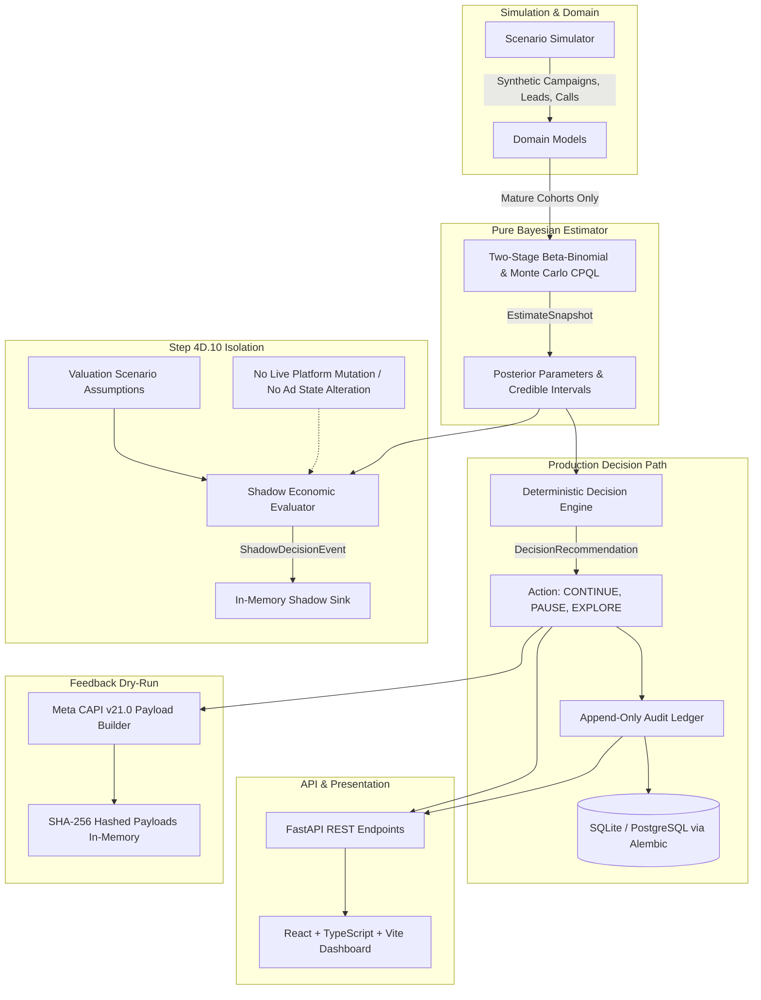

# QualLoop

**An Uncertainty-Aware Lead Qualification & Advertising Feedback System**

> ⚠ **IMPORTANT PROJECT STATUS & SCOPE**  
> QualLoop is an **empirical simulation-based MVP and research prototype** with an offline economic shadow evaluator.  
> - **Simulated Data Only:** All ad metrics, lead statuses, and sales qualification outcomes in the dashboard are generated by a deterministic scenario simulator.
> - **No Live Ad Mutation:** There is no live connection to Meta Marketing API or Google Ads API; no ad pause or budget modification is transmitted to external ad platforms.
> - **Dry-Run CAPI Only:** Meta Conversions API (CAPI v21.0) payloads are constructed and cryptographically hashed (SHA-256) in memory with zero external network transmission.
> - **Exploratory Economic Calibration:** The offline economic shadow evaluator computes incremental profit projections and break-even thresholds, but its probability-of-profitability metric is an exploratory model calculation, not calibrated for real-world empirical risk.
> - **No Authentication:** There is currently no multi-tenant authentication, user management, or role-based access control (RBAC).

---

## 1. Problem Statement

Standard advertising platforms (Meta, Google, TikTok) optimize delivery algorithms against top-of-funnel conversion signals: link clicks, landing page views, and initial lead form submissions. In industries with high-consideration sales cycles (B2B SaaS, real estate, healthcare, financial services), optimizing for raw lead volume introduces critical failure modes:

1. **The Reachability Trap (Conflating Contactability with Intent):**  
   A lead who does not answer the phone within 24 hours is uncontacted, not disqualified. When ad platforms or marketing dashboards count unreachable leads as disqualifications, they penalize high-intent audiences that simply work during business hours or take longer to answer.
2. **The Cohort Maturity Trap (Premature Decisions on Incomplete Cycles):**  
   Sales qualification takes days or weeks. Standard 7-day reporting attribution windows classify pending leads as failures, leading media buyers to prematurely pause high-performing creatives before their leads have had time to progress through the qualification pipeline.
3. **Point-Estimate Illusion in Low-Volume Regimes:**  
   Standard dashboards display raw empirical ratios (e.g., 1 qualified out of 2 contacted leads = "50% qualification rate") without credible intervals. Media buyers make budget-reallocation decisions on statistical noise, repeatedly cutting ads that are within normal variance.

QualLoop decouples **Reachability (Contactability)** from **Qualification Intent**, enforces **Cohort Maturity Gating**, represents parameter uncertainty via **Bayesian Beta-Binomial posteriors**, computes **Monte Carlo Cost-per-Qualified-Lead (CPQL) distributions**, and immutably records all recommendations to a **persisted audit trail**.

---

## 2. Statistical Methodology

QualLoop models the lead qualification pipeline as a two-stage Bayesian process evaluated only over mature cohorts:

$$\text{Observed Leads } \xrightarrow{\text{Stage 1: Reachability}} \text{Contacted Leads } \xrightarrow{\text{Stage 2: Intent}} \text{Qualified Leads}$$

### 2.1 Stage 1: Reachability ($\theta_{\text{reach}}$)
- **Cohort Gating:** Evaluated strictly on leads older than the contact maturity window (default: 3 days). Pending, recent leads are excluded from the denominator.
- **Prior:** $\text{Beta}(1, 1)$ (uninformative uniform prior over $[0, 1]$).
- **Likelihood:** $\text{Binomial}(n_{\text{mature\_leads}}, k_{\text{contacted}})$.
- **Posterior:** $\text{Beta}(1 + k_{\text{contacted}}, 1 + n_{\text{mature\_leads}} - k_{\text{contacted}})$.

### 2.2 Stage 2: Qualification Intent ($\theta_{\text{qual}}$)
- **Cohort Gating:** Evaluated strictly on mature answered contacts older than the qualification maturity window (default: 7 days). **Unreachable leads are never counted as disqualified.**
- **Prior:** $\text{Beta}(1, 4)$ (informative prior encoding a conservative ~20% qualification expectation, preventing runaway optimism from early small-sample hits).
- **Likelihood:** $\text{Binomial}(n_{\text{mature\_contacts}}, k_{\text{qualified}})$.
- **Posterior:** $\text{Beta}(1 + k_{\text{qualified}}, 4 + n_{\text{mature\_contacts}} - k_{\text{qualified}})$.

### 2.3 Expected Qualified Leads (EQL) & CPQL Uncertainty
Because Cost-per-Qualified-Lead is a nonlinear ratio of spend to random variables, point division $\frac{\text{Spend}}{\mathbb{E}[\text{QL}]}$ obscures severe right-tail skew and mathematical instability. QualLoop uses Monte Carlo propagation:
1. Draw $S = 2,000$ independent posterior samples: $\theta_{\text{reach}}^{(s)} \sim \text{Posterior}(\theta_{\text{reach}})$, $\theta_{\text{qual}}^{(s)} \sim \text{Posterior}(\theta_{\text{qual}})$.
2. Calculate simulated qualified leads: $\text{EQL}^{(s)} = N_{\text{total\_leads}} \times \theta_{\text{reach}}^{(s)} \times \theta_{\text{qual}}^{(s)}$.
3. Sample Cost per Qualified Lead: $\text{CPQL}^{(s)} = \frac{\text{Spend}}{\text{EQL}^{(s)}}$.
4. **Instability Detection:** If more than 5% of posterior mass falls near zero EQL ($\text{EQL} < 0.5$), the system flags the creative as `CPQL_UNSTABLE` rather than reporting misleading point values.

---

## 3. Architecture & Data Flow



### Architectural Guardrails Enforced in Code
- **Ground Truth Isolation:** Simulator ground truths ($p_{\text{reach}}$, $p_{\text{intent}}$) exist solely in the simulation module and are never passed to production API routers or frontend schemas.
- **Estimator Independence:** `backend/estimator/` contains pure numerical algorithms (`numpy`, `scipy`) with zero dependency on databases, web frameworks, or network I/O.
- **Deterministic Decision Policy:** Recommendation rules reside exclusively in `backend/decision_engine/` and rely strictly on observable evidence and posterior bounds, never ad-hoc frontend thresholds.
- **Shadow Isolation:** The economic evaluator runs in a non-actioning shadow mode (`backend/shadow/`). It receives snapshot data, records telemetry to an isolated sink, and returns the production decision completely unaltered.
- **Dry-Run Feedback:** The Meta CAPI module (`backend/feedback/`) formats and hashes conversion payloads without network egress.

---

## 4. Repository Structure

```
qualloop/
├── backend/
│   ├── alembic/              # Database schema migrations (authoritative DDL)
│   ├── alembic.ini           # Alembic migration configuration
│   ├── api/                  # FastAPI web application
│   │   ├── main.py           # Application entry point & CORS configuration
│   │   ├── evaluation.py     # Simulation evaluation helper
│   │   ├── routers/          # REST routers (ads, audit, benchmark, decisions, health, simulations)
│   │   └── schemas/          # Pydantic request/response schemas
│   ├── audit/                # In-memory and persisted decision audit trail
│   ├── benchmark/            # Empirical evaluation runner and holdout seeds
│   ├── decision_engine/      # Deterministic decision rules & policy versioning
│   ├── domain/               # Core Pydantic domain models
│   ├── estimator/            # Two-stage Bayesian math & Monte Carlo CPQL
│   ├── feedback/             # Meta Conversions API (CAPI v21.0) dry-run payload builder
│   ├── persistence/          # SQLAlchemy models, session factory & schema readiness verification
│   ├── shadow/               # Isolated economic shadow evaluation foundation (Step 4D.10)
│   ├── simulator/            # Synthetic ad, lead, call, and scenario generator
│   └── tests/                # Automated pytest suite (202 tests)
├── frontend/                 # React 18 + TypeScript + Vite dashboard
│   ├── src/
│   │   ├── components/       # PortfolioOverview, AdDetailModal, AuditTrailView, BenchmarkLab
│   │   ├── services/         # Typed API client (Axios)
│   │   ├── types/            # TypeScript API contract definitions
│   │   ├── App.tsx           # Application layout and navigation tabs
│   │   └── index.css         # Dark-mode styling tokens and design system
│   ├── package.json          # Node dependencies and build scripts
│   └── vite.config.ts        # Vite build configuration (proxying to :8000)
├── docs/                     # Specifications, architecture, statistical model & decision policy
├── scratch/                  # Research artifacts, ablation notes, and mathematical audit logs
├── REVIEWER_GUIDE.md         # Reviewer walkthrough, setup guide, and evaluation notes
└── README.md                 # Primary technical documentation (this file)
```

---

## 5. Verified Local Setup

The repository has been verified on Python 3.12 and Node.js 20. Setup requires two terminal windows for native local execution.

### Prerequisites
- **Python:** 3.11 or 3.12 (`python --version`)
- **Node.js:** 18+ or 20+ and npm (`node -v`, `npm -v`)

---

### Step 1: Backend Setup & API Startup

1. Open a terminal and navigate to `backend/`:
   ```bash
   cd backend
   ```

2. Create and activate a Python virtual environment:
   ```bash
   # Windows (PowerShell):
   python -m venv .venv
   .\.venv\Scripts\Activate.ps1

   # Windows (Command Prompt):
   python -m venv .venv
   .venv\Scripts\activate.bat

   # Linux / macOS:
   python3 -m venv .venv
   source .venv/bin/activate
   ```

3. Install backend dependencies in editable mode:
   ```bash
   pip install -e .
   ```

4. Configure local environment variables:
   ```bash
   # Windows (PowerShell) / Linux / macOS:
   cp .env.example .env

   # Windows (Command Prompt):
   copy .env.example .env
   ```

5. Run database migrations to initialize SQLite (`backend/qualloop.db`):
   ```bash
   python -m alembic upgrade head
   ```

6. Start the FastAPI development server:
   ```bash
   python -m uvicorn api.main:app --host 127.0.0.1 --port 8000 --reload
   ```

**Verification:**
- Open `http://127.0.0.1:8000/health` in your browser. Expected response:
  ```json
  {"status":"ok","simulated_data_only":true}
  ```
- Interactive Swagger documentation is available at `http://127.0.0.1:8000/docs`.

---

### Step 2: Frontend Setup & Dashboard Startup

1. Open a second terminal and navigate to `frontend/`:
   ```bash
   cd frontend
   ```

2. Install Node dependencies:
   ```bash
   npm install
   ```

3. Configure local environment variables:
   ```bash
   # Windows (PowerShell) / Linux / macOS:
   cp .env.example .env

   # Windows (Command Prompt):
   copy .env.example .env
   ```

4. Start the Vite development server:
   ```bash
   npm run dev
   ```

**Accessing the Dashboard:**
Open your browser to `http://127.0.0.1:3000`.

---

## 6. How to Run Tests & Builds

### Running Backend Tests
QualLoop includes comprehensive automated tests covering the Bayesian estimator, decision engine, simulation scenarios, API routes, database persistence, and shadow isolation:

```bash
# From the repository root (with backend virtualenv active):
python -m pytest backend/tests/ -v
```
*Current test suite status:* **202 passed** (0 failures).

### Building the Frontend
To verify TypeScript compilation and produce an optimized production bundle:

```bash
# From frontend/:
npm run build
```
*Current build status:* Compiles cleanly via `tsc && vite build` with zero type errors.

---

## 7. Interactive Demo Walkthrough

Once the dashboard is open at `http://127.0.0.1:3000`:

1. **Review Portfolio KPIs:** The top summary cards show aggregate Spend, Mature Lead Volume, Expected Qualified Leads (EQL) with 90% credible intervals, and CPQL stability.
2. **Trigger a Simulation Scenario:** Click **"Run Simulation"** in the top navigation bar. Select a scenario from the dropdown:
   - `delayed_conversion_trap`: High-intent leads with longer qualification delays, showing how cohort gating avoids premature false pauses.
   - `mixed_portfolio`: A heterogeneous mix of good, marginal, and poor creatives.
   - `creative_fatigue`: Creatives whose intent degrades over time.
   Enter any seed (e.g., `42`) and submit.
3. **Inspect Credible Intervals:** Scroll through the creative table. Each ad displays two horizontal credible interval bars:
   - **Stage 1 (Reachability):** Posterior mean and 90% credible interval on contacted leads.
   - **Stage 2 (Intent):** Posterior mean and 90% credible interval on mature contacts only.
4. **Open Ad Inspector:** Click any creative row to open the modal. View the mathematical decomposition:
   - Beta prior parameters vs. updated posterior parameters ($\alpha, \beta$).
   - Maturity gating checklist: mature lead count, contact count, and cohort maturity fraction.
   - Deterministic rule rationale justifying the recommendation (`PAUSE_AD`, `CONTINUE_MONITORING`, or `EXPLORE`).
5. **Inspect the Decision Audit Ledger:** Navigate to the **"Decision Audit Trail"** tab. View the append-only ledger recording every recommendation, timestamp, policy version, and supporting metrics. Click **"View Raw Payload"** to see the structured audit event.
6. **Benchmark Lab:** Navigate to the **"Benchmark Lab"** tab to view comparative empirical metrics against hidden ground truth.

---

## 8. Offline Economic Shadow Evaluator (Step 4D.10)

The production decision policy in `backend/decision_engine/` evaluates qualification rates against static statistical hurdles. In Step 4D.10, an isolated **Economic Shadow Evaluator** (`backend/shadow/`) was introduced to test economic viability decisioning:

- **Mathematical Objective:** Projects incremental contribution profit ($\Delta \Pi$) over a decision horizon:
  $$\mathbb{E}[\Delta \Pi] = \mathbb{E}[\Delta \text{QL}] \times V_{\text{QL}} - \Delta \text{Spend} - \mathbb{E}[\Delta \text{Calls}] \times C_{\text{call}}$$
  where $V_{\text{QL}}$ is the expected contribution value per qualified lead and $C_{\text{call}}$ is the variable cost per sales call.
- **Telemetry Event:** Records versioned `SHADOW_ECONOMIC_DECISION_LOGGED` events containing projected profit, break-even CPQL, and shadow actions (`CONTINUE`, `PAUSE`, `ABSTAIN`).
- **Complete Isolation:** Shadow evaluation runs asynchronously or side-by-side with zero mutation of live recommendations. If valuation parameters are unavailable, the evaluator safely yields `ABSTAIN`.
- **Calibration Status:** Categorized explicitly as `EXPLORATORY_NOT_CALIBRATED` because lead volume projections rely on deterministic run-rate extrapolations.

---

## 9. Benchmarking & Simulation Methodology

The benchmark harness (`backend/benchmark/`) evaluates QualLoop against naive point heuristics across pre-committed random seeds (`backend/benchmark/seeds_split.json`) over 100 holdout runs (175 ads across 9 scenario archetypes):

### 9.1 Return Models & Budget Accounting
- **Linear-Returns Assumption ($Spend^{1.0}$):** The primary benchmark assumes returns to advertising spend scale linearly per ad. Budget freed by pausing underperforming creatives is reallocated equally across surviving active ads, with incremental leads scaling proportionally ($1.0 \times$).
- **Diminishing-Returns Model ($Spend^{0.7}$):** To account for audience saturation, frequency fatigue, and diminishing marginal returns in digital ad auctions, the benchmark evaluates a concave return model where incremental leads scale as $\left(\frac{\text{Spend}_{\text{new}}}{\text{Spend}_{\text{base}}}\right)^{0.7}$.
- **Headline Budget Accounting:** Evaluated at a fixed total budget (₹821,000 holdout budget). Unspent budget from paused ads is reallocated to active ads, or counted as unspent waste.
- **Ground-Truth Comparator:** A Day 14 "Oracle" classifies ads using complete end-of-campaign information, serving as a heuristic upper comparator.

### 9.2 Key Empirical Finding
When naive point heuristics are tuned on dedicated training seeds (requiring 30 mature contacts before pausing at a 10% hurdle), their total qualified leads (4,840.88) are statistically indistinguishable from QualLoop (4,805.88; paired difference $\Delta = -0.35$ leads/run, $p=0.51$). QualLoop's demonstrable edge is not magical lead generation, but **principled risk control**: explicit credible intervals, elimination of reachability bias, automated maturity gating, and an immutable audit trail.

---

## 10. Known Limitations & Roadmap

| Area | Current Implementation Status | Production Roadmap |
|---|---|---|
| **Ad Platform Integration** | Simulated scenarios only. No live API credentials. | Read-only Meta & Google Ads sync; automated draft-rule dispatch. |
| **Data Ingestion** | Synthetic generator in code. | CRM webhook receiver (HubSpot/Salesforce) and daily CSV upload. |
| **Feedback Mutation** | Dry-run CAPI v21.0 payload building with SHA-256 hashing. | Configurable, customer-approved CAPI offline conversion upload. |
| **Economic Calibration** | Offline shadow prototype with uncalibrated probabilities. | Empirical probability calibration using posterior predictive sampling. |
| **Authentication & RBAC** | None (open local API). | Multi-tenant OAuth2/OIDC, team accounts, and role-based permissions. |
| **Persistence** | SQLite (local default) / PostgreSQL via Alembic. | Production RDS PostgreSQL with connection pooling. |

---

## 11. Companion Documentation

For deep technical dives, consult the specialized documentation in the repository:
- [Technical Reviewer Guide](REVIEWER_GUIDE.md): Executive summary, interactive walkthrough, and technical evaluation questions.
- [Statistical Model Specification](docs/STATISTICAL_MODEL.md): Full mathematical derivation of the two-stage Beta-Binomial estimator.
- [Decision Policy Specification](docs/DECISION_POLICY.md): Deterministic state machine rules, evidence thresholds, and rationale strings.
- [Shadow Architecture Note](scratch/step_4d10_shadow_architecture_note.md): Step 4D.10 design note on isolated shadow telemetry and event schemas.
- [Technical Readiness Audit Report](scratch/step_4d11_readiness_report.md): Step 4D.11 readiness assessment and architectural audit.
