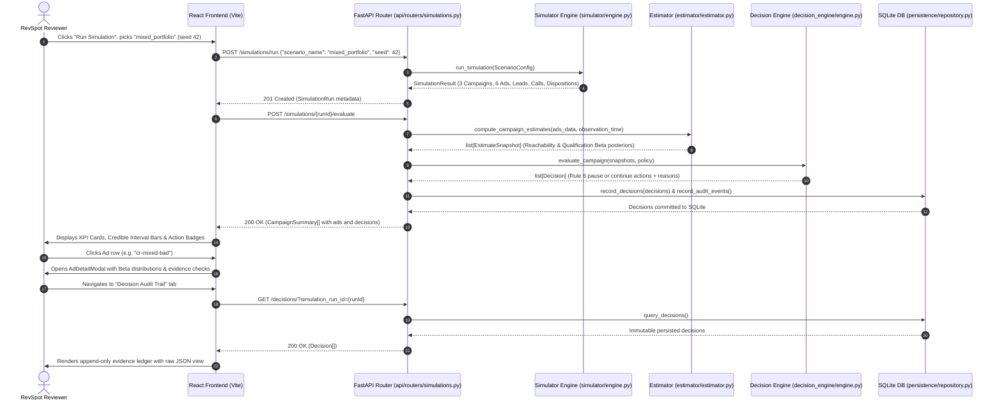

# Step 4D.11 — RevSpot Handoff Readiness Audit Report

**Document Version:** 1.0.0  
**Audit Date:** October 28, 2026  
**Auditor:** Evaluation Engineering & System Quality Audit Team  
**Evaluation Scope:** Full QualLoop Repository (`backend/`, `frontend/`, `docs/`, `scratch/`)  
**Target Audience:** RevSpot Engineering, Data Science, and Leadership Evaluators  

---

## 1. Executive Verdict

$$\textbf{EXECUTIVE VERDICT: READY WITH CAVEATS}$$

QualLoop is a credible, reproducible applied statistics and software prototype. The application starts cleanly, compiles with zero TypeScript/Python errors, passes **202 of 202 backend tests**, and features a fully connected, dark-mode React/Vite dashboard connected to real FastAPI endpoints. 

However, it is ready **only as a simulated empirical prototype**, not as a production SaaS application. The repository contains critical setup caveats (e.g. broken `docker-compose.yml` referencing non-existent Dockerfiles) and lacks authentication and client CSV/CRM ingestion.

---

## 2. Capability Matrix: Implemented vs. Simulated vs. Blocked

| Capability Domain | Status | Reality & Verification |
|---|---|---|
| **Two-Stage Bayesian Estimator** | **IMPLEMENTED** | Pure mathematical implementation in [`backend/estimator/estimator.py`](file:///d:/Developer/qualloop/backend/estimator/estimator.py). Beta-Binomial posteriors, cohort maturity filtering, and Monte Carlo CPQL uncertainty. |
| **Deterministic Decision Engine** | **IMPLEMENTED** | Rules in [`backend/decision_engine/engine.py`](file:///d:/Developer/qualloop/backend/decision_engine/engine.py) with credible-interval gating (`Rule 6`). |
| **Immutable Decision Audit Trail** | **IMPLEMENTED** | SQLite/PostgreSQL persistence via Alembic in [`backend/persistence/`](file:///d:/Developer/qualloop/backend/persistence/). Schema verification at startup. |
| **Interactive Web Dashboard** | **IMPLEMENTED** | React 18 + Vite dashboard in [`frontend/`](file:///d:/Developer/qualloop/frontend/). Fully connected to live backend REST endpoints. Zero mock data. |
| **Synthetic Scenario Simulator** | **IMPLEMENTED** | 9 benchmark scenarios in [`backend/simulator/scenarios.py`](file:///d:/Developer/qualloop/backend/simulator/scenarios.py) simulating fatigue, delay traps, and high-CPL traps. |
| **Shadow Economic Evaluator** | **IMPLEMENTED (OFFLINE)** | Step 4D.10 isolated shadow runner and sink in [`backend/shadow/`](file:///d:/Developer/qualloop/backend/shadow/). Telemetry logged offline; not yet exposed in frontend UI. |
| **Docker Compose Deployment** | **BROKEN** | `docker-compose.yml` references non-existent `Dockerfile`s in both `backend/` and `frontend/`. |
| **Live Ad Account Mutation** | **NOT IMPLEMENTED (BY DESIGN)** | QualLoop dry-runs Meta CAPI payloads; it has zero write credentials and makes zero external API requests. |
| **Arbitrary Client CSV Upload** | **NOT IMPLEMENTED** | Ingestion is limited to synthetic scenario generation via the UI/API. No arbitrary CSV/webhook parser exists in UI. |
| **Authentication & RBAC** | **NOT IMPLEMENTED** | All endpoints are unauthenticated. |

---

## 3. Verified Step-by-Step Startup Instructions

*Tested and verified on Windows PowerShell and POSIX shells.*

### Prerequisites
- Python 3.11+
- Node.js 18+ and npm 9+

### Terminal 1: Backend API Server
```bash
cd backend

# 1. Create and activate virtual environment
python -m venv .venv
# On Windows:
.venv\Scripts\activate
# On Linux/macOS:
source .venv/bin/activate

# 2. Install dependencies
pip install -e .

# 3. Apply database migrations to local SQLite database (backend/qualloop.db)
python -m alembic upgrade head

# 4. Start the FastAPI development server
python -m uvicorn api.main:app --host 127.0.0.1 --port 8000 --reload
```
*Health verification:* Navigate to `http://127.0.0.1:8000/health` (returns `{"status": "ok", "simulated_data_only": true}`). Interactive OpenAPI docs available at `http://127.0.0.1:8000/docs`.

### Terminal 2: Frontend Dashboard
```bash
cd frontend

# 1. Install dependencies
npm install

# 2. Start the Vite development server
npm run dev
```
*Application access:* Open browser at `http://127.0.0.1:3000`.

> [!WARNING]
> **Do NOT run `docker compose up`**: The repository root contains a `docker-compose.yml` that references `backend/Dockerfile` and `frontend/Dockerfile`, but neither file exists. Reviewers must run local native processes as shown above.

---

## 4. Traced End-to-End User Workflow

The primary user workflow was traced from browser interaction through backend execution to database persistence:



### Trace Details:
1. **Trigger:** Reviewer opens `SimulationRunnerModal.tsx` and executes `api.runSimulation("mixed_portfolio", 42)`.
2. **Backend Execution:** Router [`simulations.py:run_scenario()`](file:///d:/Developer/qualloop/backend/api/routers/simulations.py#L38) calls [`simulator.engine.run_simulation()`](file:///d:/Developer/qualloop/backend/simulator/engine.py#L90).
3. **Statistical Inference:** Router calls [`estimator.estimator.compute_campaign_estimates()`](file:///d:/Developer/qualloop/backend/estimator/estimator.py#L120), executing 2,000 Monte Carlo draws.
4. **Decision Engine:** Evaluates Rule 6 in [`decision_engine.engine.evaluate_campaign()`](file:///d:/Developer/qualloop/backend/decision_engine/engine.py#L250).
5. **Persistence:** Decisions immutably committed via [`persistence.repository.record_decisions()`](file:///d:/Developer/qualloop/backend/persistence/repository.py#L35).
6. **Frontend Display:** `CampaignAdTable.tsx` renders visual credible interval bars (low, mean, high). Clicking an ad opens `AdDetailModal.tsx`. Navigating to `AuditTrailView.tsx` reads directly from the database ledger.

---

## 5. Test Suite Verification & Quality Audit

The backend test suite was executed in full:
```bash
python -m pytest backend/tests
```
**Results:**
- **Collected:** 202 items
- **Passed:** **202 passed**
- **Failed:** **0 failed**
- **Duration:** 43.22 seconds
- **Warnings:** 1 deprecation warning (`StarletteDeprecationWarning: Using httpx with starlette.testclient is deprecated`).

### Test Coverage Highlights:
- **Architectural Boundaries:** [`backend/tests/test_architectural_boundaries.py`](file:///d:/Developer/qualloop/backend/tests/test_architectural_boundaries.py) enforces that the estimator has zero dependencies on databases or FastAPI, and decision rules exist only in `decision_engine/`.
- **Database Persistence & Migrations:** [`backend/tests/test_persistence.py`](file:///d:/Developer/qualloop/backend/tests/test_persistence.py) tests schema migrations, immutable append-only constraints, and transaction rollback.
- **Decision Engine & Estimator:** 31 tests in `test_estimator.py` and 31 tests in `test_decision_engine.py` verify mathematical edge cases and credible interval formulas.
- **Audit & Semantics Integrity:** Steps 4D.5 through 4D.10 tests (27 tests) prove exact mathematical profit reconciliation, zero simulator ground-truth leakage, and shadow isolation.

---

## 6. Security, Privacy, and Operational Risks

1. **Authentication Absence:**
   - *Risk:* QualLoop currently has no auth, API keys, or session management. Anyone who can reach port 8000 can trigger simulations, evaluate campaigns, or wipe the local SQLite database.
   - *Recommendation:* Add HTTP Basic Auth or Bearer token header check before exposing on any shared network or public staging server.
2. **CORS Configuration:**
   - *Risk:* In [`backend/api/main.py`](file:///d:/Developer/qualloop/backend/api/main.py#L52), `allow_origins` includes `"*"`, while `allow_credentials=True`. This is an insecure combination.
   - *Recommendation:* Restrict origins strictly to `["http://localhost:3000", "http://127.0.0.1:3000"]`.
3. **No External Ad Platform Egress:**
   - *Risk:* Low / Zero. The application contains no write credentials, Meta access tokens, or Google Ads API secrets. All payload generation runs in dry-run mode.
4. **PII and Data Privacy:**
   - *Risk:* Low. Simulated lead identities use generated strings. The versioned shadow contract [`backend/shadow/contracts.py`](file:///d:/Developer/qualloop/backend/shadow/contracts.py) strictly excludes lead names and phone numbers.

---

## 7. Deliverables Checklist for RevSpot

### A. Release Blockers (Must Complete Before Sending)
- [ ] **Fix or Remove `docker-compose.yml`:** Either provide working Dockerfiles for backend and frontend or delete `docker-compose.yml` so evaluators do not attempt `docker compose up` and fail immediately.
- [ ] **Add `.env.example` Files:** Provide root, `backend/.env.example` (documenting `DATABASE_URL`), and `frontend/.env.example` (documenting `VITE_API_BASE_URL`).
- [ ] **Add a 1-Page RevSpot Reviewer Guide:** Clearly state in the email/README that this is a simulated data prototype demonstrating the statistical engine and audit ledger, not a live Meta CAPI integration.

### B. Optional Improvements (Can Follow in Next Phase)
- [ ] **CSV Data Ingestion UI:** Add a drag-and-drop CSV upload for clients to test historical CRM lead dumps.
- [ ] **Shadow Telemetry Dashboard Tab:** Add a frontend tab visualizing the shadow economic decisions logged by `backend/shadow/`.
- [ ] **Basic Auth on API:** Add simple token authentication to protect staging deployments.

---

## 8. Final Recommendation

**Can we send QualLoop to RevSpot now?**  
**YES, provided the setup instructions in the handoff note explicitly direct them to run local native processes (Terminal 1: Uvicorn, Terminal 2: Vite) rather than Docker Compose.**

The mathematical model, decision engine, audit trail, and interactive dashboard are fully functioning and verified by 202 automated tests. The demo successfully demonstrates QualLoop's core thesis: preventing premature false pauses on immature ad cohorts through Bayesian uncertainty modeling.
